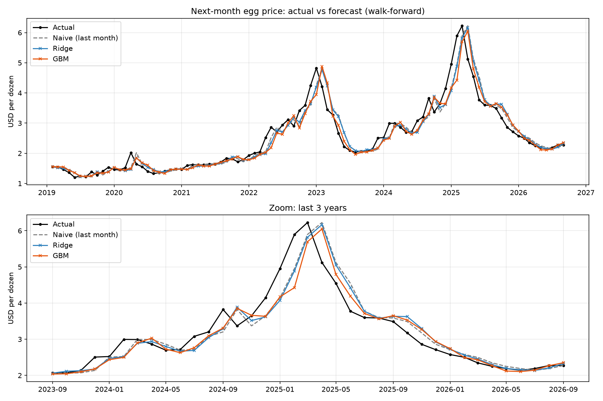

# พยากรณ์ราคาไข่ไก่ล่วงหน้า 1 เดือน เพื่อวางแผนจัดซื้อเสบียง

**CPE312 · DS Capstone Project** · SDG 2: Zero Hunger

ทำนายราคาเฉลี่ยไข่ไก่ Grade A ขนาดใหญ่ (USD ต่อโหล, U.S. city average) **ล่วงหน้า 1 เดือน** ให้ฝ่ายจัดซื้อเสบียง (โรงอาหาร, โครงการอาหารกลางวัน, food bank) ใช้ตั้งงบซื้อไข่เดือนหน้า และตัดสินใจว่าควรซื้อตุน ซื้อตามปกติ หรือหาโปรตีนทดแทน

## สมาชิกกลุ่ม

กลุ่ม **เกลียดตัวกินไข่** · มหาวิทยาลัยศรีนครินทรวิโรฒ

| ชื่อ-นามสกุล | รหัสนิสิต |
|---|---|
| นายธนวัฒน์ เทียนอร่าม | 67109010185 |
| นายธาวิน ยั่งยืนวณิชสกุล | 67109010187 |
| นางสาวพิชญ์สินี มโนมณีรัตน์ | 67109010397 |

## ข้อมูล

- **ราคาไข่:** U.S. Bureau of Labor Statistics, Average Price Data (series `APU0000708111`) 561 เดือน (1980-01 → 2026-09)
- **จำนวนแม่ไก่ไข่:** USDA NASS Quick Stats (2007-12 → 2025-12)
- **ไข้หวัดนกในฟาร์ม:** USDA APHIS HPAI confirmed detections (2022-02 → 2026-11)

รายละเอียดแต่ละไฟล์อยู่ใน [`data/README.md`](data/README.md)

## วิธีทำ

1. **ทำความสะอาด:** บังคับให้มีครบทุกเดือนแล้ว interpolate เดือนที่ว่าง, เลือกชุดข้อมูลแม่ไก่และฟาร์มไก่ไข่ที่ถูกต้อง
2. **EDA:** ราคามีเทรนด์ → ทาย log-return เดือนหน้าแทนระดับราคา, ความผันผวนเกาะกลุ่ม, มีฤดูกาลบางส่วน, autocorrelation มีนัยสำคัญ
3. **Features:** การเปลี่ยนแปลงราคา 3 เดือนล่าสุด, ความผันผวน 3 เดือน, ราคาเทียบค่าเฉลี่ย 12 เดือน, เดือนของปี (sin/cos) + (การทดลอง B) แม่ไก่ไข่ lag 1 เดือน และไก่ไข่ที่ติดไข้หวัดนก
4. **โมเดล:** Naive (ราคาเท่าเดือนนี้, baseline), Ridge, Gradient Boosting
5. **ประเมิน:** walk-forward ทุกเดือนตั้งแต่ 2019-01 (เทรนใหม่ด้วยข้อมูลก่อนเดือนนั้นเท่านั้น) วัดด้วย MAE, RMSE, MASE, spike recall

## ผลลัพธ์

**การทดลอง A: ราคาย้อนหลังอย่างเดียว** (ทดสอบ 92 เดือน, 2019-01 → 2026-08)

| โมเดล | MAE ($/โหล) | MASE | Spike recall |
|---|---|---|---|
| Naive (baseline) | 0.212 | 1.000 | 0/14 |
| Ridge | 0.212 | 1.002 | 0/14 |
| **GBM** | **0.208** | **0.981** | 0/14 |

- โมเดลดีกว่า baseline เพียงเล็กน้อย (< 5%) และเตือนราคาพุ่งไม่ทันเลย เพราะสาเหตุ (โรคระบาดในฟาร์ม) ไม่อยู่ในข้อมูลราคา
- **การทดลอง B** (เพิ่มแม่ไก่ + ไข้หวัดนก): เตือนราคาพุ่งได้ 3/5 ครั้งในช่วงประเมิน แต่เตือนผิด 5 ครั้ง และ MAE แย่ลง
- **ช่วงคลาดเคลื่อนสำหรับตั้งงบ (P10–P90):** ช่วงปกติ −5.9% ถึง +10.3% · ช่วงผันผวน −11.2% ถึง +15.5% → ควรเผื่องบสำรองตาม P90

ตัวเลขทั้งหมดอยู่ใน [`results/output/summary.txt`](results/output/summary.txt) กราฟอยู่ใน [`results/figures/`](results/figures/) และโปสเตอร์อยู่ที่ [`results/poster_egg_price.html`](results/poster_egg_price.html)



## โครงสร้างโปรเจกต์

```
egg-price-forecast/
├── README.md
├── data/
│   ├── raw/                 # ข้อมูลต้นฉบับ (BLS, NASS, APHIS)
│   ├── processed/           # ข้อมูลหลังทำความสะอาด + features
│   └── README.md            # คำอธิบายชุดข้อมูล
├── src/
│   ├── main.py              # รันทั้ง pipeline
│   ├── preprocess.py        # โหลดและทำความสะอาดข้อมูล
│   ├── analysis.py          # EDA, สร้าง features, โมเดล, วิเคราะห์ความผิดพลาด
│   └── config.py            # ค่าคงที่และ path
├── results/
│   ├── figures/             # กราฟ (.png)
│   ├── output/              # ตารางผลลัพธ์ (.csv) และ summary.txt
│   └── poster_egg_price.html
├── notebooks/
│   ├── DS_Capstone_v2_extra.ipynb   # notebook ฉบับเต็มพร้อมคำอธิบายทุกขั้น
│   └── DS_Capstone_v2_extra.html
├── requirements.txt
└── .gitignore
```

## วิธีรัน

```bash
pip install -r requirements.txt
python src/main.py
```

ใช้เวลาประมาณ 2–3 นาที (walk-forward เทรนโมเดลใหม่ทุกเดือน) แล้วจะได้

- `data/processed/*.csv`: ข้อมูลที่ทำความสะอาดแล้ว
- `results/figures/*.png`: กราฟ EDA และผลโมเดล 12 รูป
- `results/output/*.csv`, `summary.txt`: ตารางเปรียบเทียบโมเดลและตัวเลขสรุป

หรือเปิด `notebooks/DS_Capstone_v2_extra.ipynb` เพื่อดูการวิเคราะห์ทีละขั้นพร้อมคำอธิบาย
